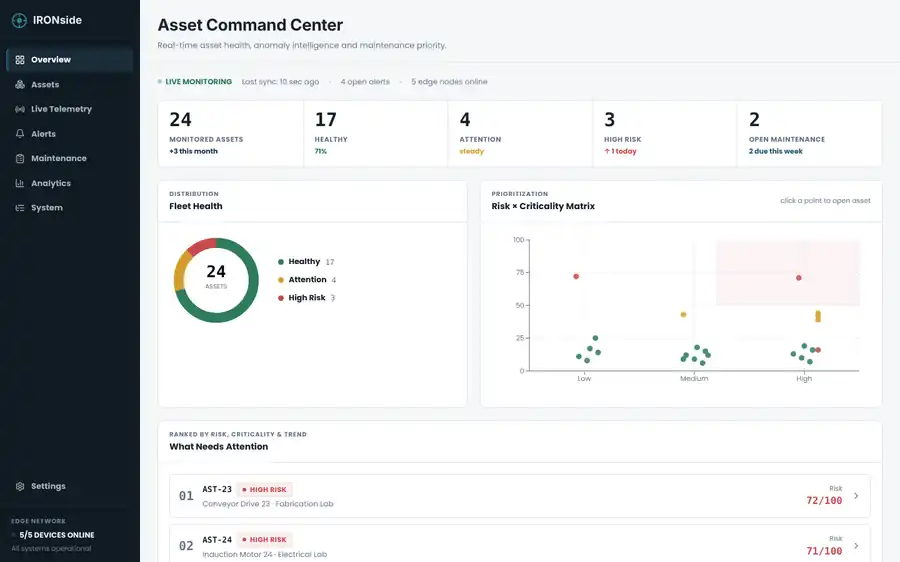
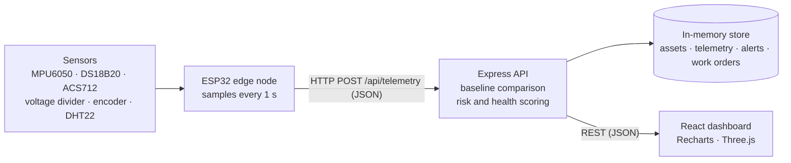

# IRONside: Industrial Asset Health Dashboard

A predictive-maintenance prototype that joins hardware and software: an ESP32 reads sensors on a machine, an Express API scores the machine's health and raises alerts, and a React dashboard shows the fleet with live charts and 3D machine models.

Team project for the Smart India Hackathon internal round at **NIT Raipur** (Top 50 teams).



Screenshot of the app running locally on its bundled demo dataset, not a live sensor feed.

## Architecture



## What is real and what is simulated

| Part | Status |
| --- | --- |
| ESP32 firmware | Written for the wiring below; reads six sensors and posts JSON to the API. |
| Telemetry API | Implemented. Accepts packets, validates them, updates risk and health, opens alerts. |
| Anomaly detection | **Threshold-based.** Readings are compared with each asset's baseline range. There is no trained ML model. |
| Dashboard data | **Demo dataset.** The 24 assets and their histories are seeded. `GET /api/sensor-data` returns simulated readings, and the dashboard falls back to locally simulated values when the API is unreachable. |
| Storage | **In-memory.** Data resets on restart. A MongoDB schema is sketched in `backend/src/models/SensorReading.js` but is not connected. |
| Authentication | None. |

## Hardware

Target board: ESP32 DevKit v1 / NodeMCU-32S. Pin assignments are taken from `backend/esp32_firmware/esp32_sensor_node.ino`.

| Measurement | Sensor | Interface | ESP32 pin |
| --- | --- | --- | --- |
| Vibration | MPU6050 | I2C | SDA GPIO 21, SCL GPIO 22 |
| Temperature | DS18B20 | OneWire, 4.7 kΩ pull-up | GPIO 4 |
| Current | ACS712 (20 A / 30 A) | Analog | GPIO 34 |
| Voltage | 0–25 V divider module | Analog | GPIO 35 |
| Speed (RPM) | Optical interrupter / encoder | Interrupt | GPIO 18 |
| Humidity | DHT22 | Digital | GPIO 5 |

To flash it, open the sketch in the Arduino IDE, install the `OneWire`, `DallasTemperature`, `DHT sensor library` and `ArduinoJson` libraries, set `ssid`, `password`, `serverUrl` and `ASSET_ID` at the top of the file, and upload. The node sends one packet per second.

## Run it

Backend:

```bash
cd backend
npm install
cp .env.example .env
npm run dev          # http://localhost:5000
```

Dashboard, in a second terminal:

```bash
cd frontend
npm install
npm run dev          # http://localhost:5173
```

To point the dashboard at an API on another machine, create `frontend/.env` with `VITE_API_URL=http://<host>:5000`.

## API

| Area | Endpoints |
| --- | --- |
| Assets | `GET /api/assets`, `GET /api/assets/:id`, `PATCH /api/assets/:id` |
| Telemetry | `POST /api/telemetry`, `POST /api/telemetry/ingest`, `GET /api/telemetry/:assetId` |
| Alerts | `GET /api/alerts`, `POST /api/alerts`, `PATCH /api/alerts/:id` |
| Maintenance | `GET /api/maintenance`, `POST /api/maintenance`, `PATCH /api/maintenance/:id` |
| System | `GET /api/system/status`, `GET /health` |
| Demo | `GET /api/sensor-data` (simulated readings) |

Example payloads are in [`backend/README.md`](backend/README.md).

## How scoring works

Each asset stores a baseline range for vibration, current and temperature. When a packet arrives, the API measures how far each reading sits outside its range, updates the asset's risk and health scores, and opens an alert when the asset crosses into high risk.

## Checks

- `npm run build` in `frontend/` succeeds, and it runs in GitHub Actions on every push together with a syntax check of the backend.
- There are no automated tests yet.
- `npm run lint` in `frontend/` does not run: the ESLint configuration file is missing.

## My contribution

I ([Amit Singh Bisht](https://github.com/AmitSingh-23)) built the Express API and the React dashboard views, including the charts and 3D machine models.

## Next steps

- Persist telemetry and alerts in MongoDB
- Replace baseline thresholds with a trained anomaly model
- Add authentication and API tests

## License

MIT. See [`LICENSE`](LICENSE).
